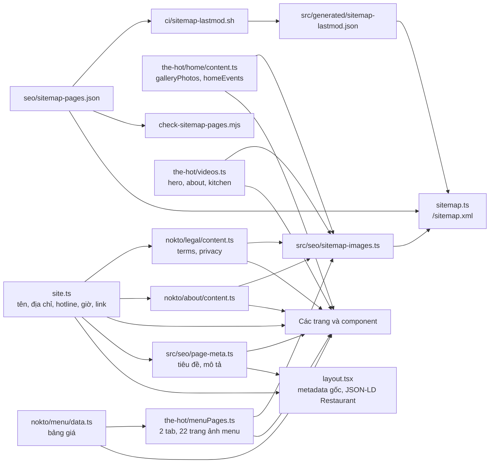
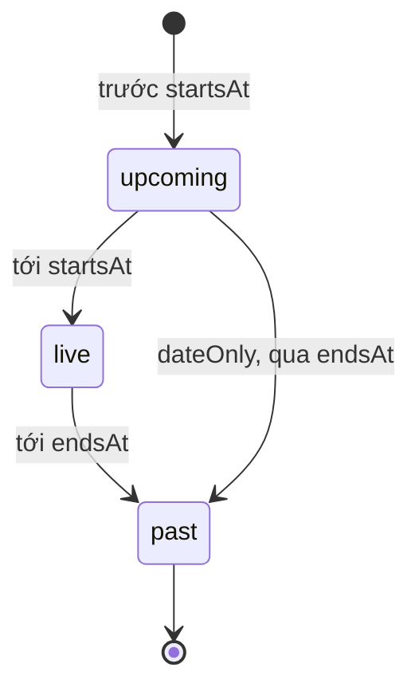

# Mô hình dữ liệu nội dung

> Trạng thái: Đang áp dụng · Cập nhật: 2026-10-19 · Liên quan: [Kiến trúc](ARCHITECTURE.md), [Đặc tả sản phẩm](../product/spec.md), [Front-end](../dev/frontend.md), [Kiểm thử](../dev/testing.md), [Mục lục ADR](../adr/README.md)

Site không có cơ sở dữ liệu. "Dữ liệu" là các module TypeScript, file JSON và file trong `public/` mà trang, metadata, JSON-LD và sitemap cùng đọc. Nguồn sự thật là chính các file đó (kiểu TypeScript là schema); file này giải thích điều code không nói: ai đọc gì, bất biến nào không được phá, và đổi dữ liệu thế nào. Tính tới 2026-10-14.

## 1. Phạm vi và nguồn sự thật

| Hạng mục | Giá trị |
|---|---|
| Cơ sở dữ liệu | Không có |
| Schema | Kiểu TypeScript trong từng module (`MenuContent`, `HomeEvent`, `GalleryPhoto`, `SiteVideo`…); `tsc --noEmit` ở chế độ strict kiểm |
| Cấu hình SEO | `seo/sitemap-pages.json` (kiểm bằng `seo/check-sitemap-pages.mjs`), `src/seo/page-meta.ts`, `src/seo/sitemap-images.ts` |
| Dữ liệu sinh lúc CI | `src/generated/sitemap-lastmod.json` (git-ignored, do `ci/sitemap-lastmod.sh` ghi) |
| File tĩnh | `public/sites/the-hot-beer-garden/` (ảnh, font, logo của quán), `public/videos/`, `public/images/`; `public/sites/nokto/` là tài sản của template NOKTO |
| Thay đổi dữ liệu | Sửa file, mở PR, merge; Jenkins build và deploy. Không có thao tác sửa trên máy chủ |

## 2. Nguyên tắc thiết kế

1. **Một thông tin, một nguồn.** Giao diện, metadata, JSON-LD và sitemap import từ module dữ liệu, không gõ lại. Vì Google đối chiếu thông tin quán ở nhiều nơi (bất biến I-01, I-02).
2. **Dữ liệu mà code phía server cần thì không nằm trong file `"use client"`.** Giá trị export từ module client chỉ là client reference ở phía server (lý do tách `menuPages.ts` khỏi `MenuBook.tsx`, PR #3).
3. **Đường dẫn ảnh đi qua helper:** `hotImage(file)` cho ảnh của quán, `siteImage(file)` cho tài sản template (cả hai trong `site.ts`).
4. **Thời gian sự kiện** ghi ISO 8601 kèm múi giờ `+07:00`; hiển thị theo `Asia/Ho_Chi_Minh`.
5. **Giá** là số nguyên VND, đã gồm VAT.
6. **Thông tin kinh doanh mới** (giờ, giá, sự kiện, món) phải có nguồn từ chủ quán trước khi vào code.

## 3. Ai đọc gì

## 4. Quy ước chung

| Quy ước | Giá trị |
|---|---|
| Khoá | Đường dẫn trang (`"/menu"`) cho cấu hình SEO; `id` dạng kebab-case cho sự kiện và ảnh gallery |
| Thời gian | Chuỗi ISO 8601 có múi giờ; ngày `lastmod` là committer date (`%cI`) của git |
| Ảnh | Đường dẫn tuyệt đối từ gốc site (`/sites/...`); sitemap đổi thành URL tuyệt đối trên `NEXT_PUBLIC_SITE_URL` |
| Văn bản hiển thị | Tiếng Việt, nằm trong module dữ liệu, không rải trong JSX khi có thể |

## 5. Thực thể chi tiết

### 5.1 Thông tin quán: `site` (`src/components/sites/nokto/site.ts`)

| Trường | Ý nghĩa | Ai đọc |
|---|---|---|
| `name`, `location` | "The Hot Beer Garden", "Đà Lạt" | Metadata, JSON-LD, `brandName` |
| `slogan`, `sloganLines`, `rootTitle` | Slogan "Đà Lạt lên đèn, The Hot lên mood." và tiêu đề chia sẻ trang chủ | H1 trang chủ, Open Graph trang chủ ([ADR 0005](../adr/0005-separate-search-titles-from-headings.md)) |
| `rootDescription`, `schemaDescription` | Mô tả trang chủ; mô tả trong JSON-LD | Metadata gốc, JSON-LD |
| `address` (`street`, `city`, `region`, `country`, `display`) | 28 Sương Nguyệt Ánh, P. Lâm Viên, Đà Lạt, Lâm Đồng, VN | Footer, `/terms`, `/about`, JSON-LD, mô tả trang |
| `phone`, `phoneHref` | Hotline hiển thị và link `tel:` | Footer, nút Gọi, form đặt bàn, JSON-LD (`telephone`) |
| `hours` (`opens`, `display`) | "17:30", "17:30 – Late" | Footer, `/terms`, `/about`, mô tả trang. Đang lệch Google Maps (mục 11) |
| `socialHref`, `messengerHref`, `zaloHref` | Facebook, Messenger, Zalo của quán | Nút liên hệ nhanh; `socialHref` còn ở footer, menu điều hướng, bước cuối form đặt bàn, khối sự kiện trang chủ, JSON-LD `sameAs` |
| `profiles` (`instagram`, `tiktok`, `google`, `tripadvisor`) | Instagram, TikTok, hồ sơ Google, TripAdvisor của quán | JSON-LD `sameAs` (cả bốn); footer (Instagram, TikTok) |
| `logo`, `nav`, `footerNav`, `cta`, `legal` | Logo, menu điều hướng, dòng link trang ở footer, nút Đặt bàn, link trang pháp lý. `nav`, `footerNav`, `legal` lấy từng link từ `pageLinks` (một nhãn, một đường dẫn cho mỗi trang) | Khung trang (`chrome/`): `footerNav` ở `SiteFooter` |
| `beerOffer` | Câu ưu đãi bia Chủ nhật đến thứ Năm | Bảng giá, `/terms` |
| `rootOgDescription` | Mô tả chia sẻ ngắn | Chưa có nơi nào đọc (2026-10-14) |

### 5.2 Menu

| Module | Nội dung | Trang |
|---|---|---|
| `src/components/sites/nokto/menu/data.ts` | `menu: MenuContent` gồm 2 nhóm (`groups`, `MenuGroup`: `id` `an_choi` \| `premium`, `label`, `summary`, `categories`). "Món ăn chơi": 8 nhóm món, 34 món (26 món ăn, 8 bia và cider). "Premium": 15 nhóm món, 104 món (5 combo, 3 mẹt, 83 món lẻ, 13 đồ uống). `MenuItem`: `name`, `subtitle` (tên tiếng Anh cho khách nước ngoài), `description` (thành phần combo, mẹt, tháp), `price` là số VND đã gồm VAT; `MenuCategory.short` là nhãn ngắn của nút lọc khi tên nhóm là tên vui ("Sục sôi" → "Lẩu"). `menuGroups`: hai tab dùng chung cho bảng giá và sách lật | `/menu/list`, nhãn tab của `/menu` |
| `src/components/sites/the-hot/menuPages.ts` | `menuBooks`: mỗi nhóm một cuốn (`id`, `label`, `summary` lấy từ `menuGroups`; `base` là thư mục ảnh; `pages` gồm `file`, `label`, `alt`). "Món ăn chơi": 10 trang ảnh đăng trên Facebook tháng 9/2026 (`facebook-post-menu-2026-09/`). "Premium": 12 trang ảnh xuất từ file PDF menu chủ quán gửi (thiết kế trên Canva, tạo 2026-09-06), trang 12–22 và 24 (`menu-premium-2026-09/`, JPEG 1414×2000); bỏ bìa và trang bia (đã có ở "Món ăn chơi"). `menuPageSrc(book, page)` | `/menu` (sách lật), sitemap ảnh |

Hai module mô tả cùng một menu giấy (bất biến I-07). Ảnh trang menu giữ nguyên như bản in; bản chữ ở `data.ts` sửa các lỗi chắc chắn của bản in (chính tả tiếng Anh, thiếu dấu cách, tên dịch nhầm, hai món in trùng) và ghi "mực một nắng" thống nhất. Chỗ chưa chắc giữ nguyên chữ in và chờ chủ quán trả lời ([Q16–Q24](../plan/tasks.md#câu-hỏi-chờ-chủ-quán)).

### 5.3 Sự kiện: `HomeEvent` (`src/components/sites/the-hot/home/events.ts`), dữ liệu `homeEvents` (`home/content.ts`)

| Trường | Kiểu | Ghi chú |
|---|---|---|
| `id` | chuỗi | Duy nhất trong danh sách |
| `title`, `subtitle`, `description` | chuỗi | Hiển thị ở dòng sự kiện trang chủ |
| `poster`, `posterAlt` | chuỗi | Ảnh thật của quán; cũng vào sitemap ảnh của `/` |
| `tags` | mảng chuỗi | |
| `timing` | `{ kind: "scheduled", startsAt, endsAt, dateOnly? }` hoặc `{ kind: "announcement", dateLabel }` | `dateOnly: true` khi chỉ biết ngày, không biết giờ diễn |
| `sourceHref` | chuỗi, tuỳ chọn | Link nguồn (bài đăng) |
| `illustrative` | boolean, tuỳ chọn | `true` = chương trình minh hoạ, chưa có lịch thật; UI ghi "Chương trình minh hoạ" |

Tính tới 2026-10-14 có 5 mục: 1 sự kiện có ngày thật ("Sạc pin đêm", 10/10/2026, `dateOnly`), 4 chương trình minh hoạ.

### 5.4 Ảnh và video

| Module | Nội dung |
|---|---|
| `home/content.ts` → `galleryPhotos` | 5 ảnh quán (`id`, `src`, `alt`, `title`, `caption`, `category`: `space` \| `friends` \| `food`), cắt từ video quán cung cấp |
| `nokto/about/content.ts` → `about` | Nội dung `/about`: đoạn văn, ảnh, gallery 3 ảnh, số liệu nổi bật |
| `the-hot/videos.ts` | `heroVideo` (AV1 trước, H.264 720p dự phòng; bản AV1 kèm thông số luồng hình cho `mediaCapabilities`; ảnh poster), `aboutVideo` và `kitchenVideo` (AV1 trước, H.264 dự phòng) |
| `nokto/legal/content.ts` | `terms` ("Thông tin đặt bàn") và `privacy`, mỗi tài liệu một ảnh và các mục |

### 5.5 Cấu hình sitemap: `seo/sitemap-pages.json`

| Trường | Kiểu | Ý nghĩa |
|---|---|---|
| `pages[]` | `{ path, sources[] }` | Trang có trong sitemap; `sources` là file và thư mục tạo nên nội dung nhìn thấy của trang (đầu vào cho `lastmod`) |
| `shared[]` | mảng đường dẫn | File hiện trên mọi trang (`site.ts`, `SiteFooter.tsx`) và `src/seo/page-meta.ts` (tiêu đề, mô tả cho tìm kiếm của mọi trang nằm chung một file): đổi một trong các file này làm đổi `lastmod` của mọi trang |
| `exclude[]` | mảng đường dẫn trang | Trang cố ý để ngoài sitemap (`/privacy`) |
| `dynamic[]` | mảng mẫu route, tuỳ chọn | Route động như `/su-kien/[slug]`, phải khai riêng (chưa có) |

`src/generated/sitemap-lastmod.json` có dạng `{ "/": "2026-10-14T09:39:54+07:00", ... }`: với mỗi trang, ngày commit cuối trên `main` chạm vào `sources` hoặc `shared`. Thiếu file thì sitemap bỏ `<lastmod>` thay vì bịa ngày ([ADR 0004](../adr/0004-automate-sitemap-from-page-config-and-git.md)).

`lastmod` cố ý ước lượng dư: thà đổi ngày của một trang không đổi còn hơn bỏ sót trang đổi, vì sau mỗi deploy các trang có `lastmod` đổi được gửi cho Google và IndexNow ([ADR 0009](../adr/0009-notify-search-engines-after-deploy.md)). Hai chỗ dư đã biết: sửa tiêu đề hoặc mô tả của một trang trong `page-meta.ts` làm đổi ngày mọi trang; `the-hot/videos.ts` là nguồn của `/`, `/menu/list`, `/about`, `/reservation` nên đổi một video làm đổi ngày cả bốn trang.

### 5.6 Tiêu đề và mô tả cho tìm kiếm: `src/seo/page-meta.ts`

| Tên | Ý nghĩa |
|---|---|
| `brandName` | "The Hot Beer Garden Đà Lạt"; layout nối " — `brandName`" vào tiêu đề mọi trang con |
| `homeTitle` | `<title>` trang chủ: "The Hot Beer Garden Đà Lạt — Quán Nhậu Chill, Bia Lạnh" |
| `pageMeta[path]` | `title`, `description` của 6 trang con |
| `pageMetadata(path)` | Tạo metadata trang con: title, description, canonical, Open Graph kèm ảnh chia sẻ chung `/opengraph-image.png` (1200×630) |

### 5.7 Form đặt bàn (chỉ trong trình duyệt)

Trạng thái form nằm trong state React của `ReservationForm.tsx`: ngày, giờ (khung 17:30–21:00), số khách (1–8), tên, họ, email và điện thoại (không bắt buộc), ghi chú (tối đa 500 ký tự), xác nhận chính sách. Không có bản lưu nào ngoài bộ nhớ của tab (bất biến I-08).

## 6. Trường dẫn xuất

| Trường | Tính từ | Tính ở đâu | Lưu hay tính lại |
|---|---|---|---|
| Trạng thái sự kiện (`upcoming`, `live`, `past`) | `timing` và giờ hiện tại | Trình duyệt (`getEventStatus`), cập nhật mỗi phút | Tính lại; server không render trạng thái |
| `<lastmod>` của sitemap | Lịch sử git trên `main` | Agent Jenkins (`ci/sitemap-lastmod.sh`) | Sinh mỗi build, đóng vào HTML tĩnh của `/sitemap.xml` |
| `<image:loc>` của sitemap | Module dữ liệu trang | `src/seo/sitemap-images.ts` lúc build | Tính lại mỗi build |
| `telephone` trong JSON-LD | `site.phoneHref` bỏ tiền tố `tel:` | `layout.tsx` | Tính lại mỗi build |
| `brandName`, `homeTitle` | `site.name`, `site.location` | `page-meta.ts` | Tính lại mỗi build |

## 7. Bất biến

| Mã | Bất biến | Giữ bằng | Kiểm |
|---|---|---|---|
| I-01 | Tên, địa chỉ, hotline, giờ mở cửa chỉ khai một lần ở `site.ts`; mọi chỗ khác đọc từ đó | Import từ `site` | Kiểm tay: `grep -rn "Sương Nguyệt Ánh\|0967\|17:30" src`. **Còn lệch (2026-10-14):** `site.rootDescription` và `site.schemaDescription` gõ lại địa chỉ, giờ, hotline; `pageMeta["/reservation"].description` gõ lại "28 Sương Nguyệt Ánh"; `about.numbers` gõ cứng 28 và 17:30; `reservation.availableTimes` bắt đầu 17:30 độc lập với `site.hours.opens` |
| I-02 | JSON-LD chỉ chứa thông tin cũng hiện trên trang và đã được chủ quán xác nhận (không thêm giờ, `priceRange`, `Event` khi chưa chốt) | `restaurantSchema` dựng từ `site` | Rich Results Test; review |
| I-03 | Mọi route trong `src/app` được khai trong `seo/sitemap-pages.json` (`pages`, `exclude` hoặc `dynamic`); `sources` của mỗi trang tồn tại và chứa file page của trang | `seo/check-sitemap-pages.mjs` | `npm run check:sitemap`, bước Check trên Jenkins |
| I-04 | Mọi URL trong sitemap có `<lastmod>`; mọi `<loc>` và `<image:loc>` nằm trên domain của site và trả 200 (ảnh trả `image/*`) | `ci/sitemap-lastmod.sh`, `sitemap.ts` | `ci/smoke-test.sh` |
| I-05 | Sitemap ảnh chỉ có ảnh thật của quán: không ảnh nền template, SVG trang trí, icon, logo hay ảnh OG; mỗi ảnh một lần mỗi trang, dùng file gốc (không `/_next/image`) | Quy tắc trong `src/seo/sitemap-images.ts` | Review; smoke test kiểm kiểu `image/*` |
| I-06 | Sự kiện có `illustrative: true` luôn có nhãn minh hoạ trên UI và không bao giờ vào JSON-LD `Event` | `EventTimeline.tsx` | Review |
| I-07 | Giá và tên món trong `menu/data.ts` khớp ảnh menu trong `menuPages.ts` (trừ lỗi in đã sửa có chủ đích, ghi ở mục 5.2); nhóm trong `data.ts` và cuốn trong `menuPages.ts` cùng `id`, cùng thứ tự | `menuBooks` dựng từ `menuGroups` | Kiểm tay mỗi lần đổi menu |
| I-08 | Dữ liệu form đặt bàn không rời trình duyệt và không được ghi vào storage | `ReservationForm.tsx` chỉ dùng state React | AC-06 ở [đặc tả](../product/spec.md#7-tiêu-chí-nghiệm-thu-cấp-sản-phẩm) |
| I-09 | Tiêu đề và mô tả cho tìm kiếm chỉ nằm ở `src/seo/page-meta.ts`; H1 và slogan hiển thị nằm ở module giao diện | Cấu trúc module | Review ([ADR 0005](../adr/0005-separate-search-titles-from-headings.md)) |

## 8. Vòng đời trạng thái: sự kiện

Sự kiện `dateOnly` không có trạng thái `live` (không biết giờ diễn). Sự kiện đã qua vẫn hiện ở bộ lọc "Đã diễn ra" cho tới khi bị xoá khỏi `homeEvents`; xoá bằng PR khi chủ quán muốn.

## 9. Kích thước

| Dữ liệu | Số lượng (2026-10-14) |
|---|---|
| Trang trong sitemap | 6 (`/`, `/menu`, `/menu/list`, `/about`, `/reservation`, `/terms`); `/privacy` để ngoài |
| Mục trong sitemap ảnh | 37 mục, 31 file ảnh khác nhau (PR #3; thêm 12 trang menu Premium 2026-10-15) |
| Menu | 2 tab. Sách lật: 10 + 12 trang ảnh. Bảng giá: 8 + 15 nhóm, 34 + 104 = 138 món |
| Gallery trang chủ | 5 ảnh |
| Sự kiện trang chủ | 5 (4 minh hoạ) |
| Video | Hero 103 s: AV1 1080p 26,8 MB và H.264 720p 31,5 MB (PR #16); about và kitchen mỗi video có bản AV1 và H.264, mỗi bản dưới 12 MB |

## 10. Đổi dữ liệu thế nào

- **Đổi tên, địa chỉ, hotline, giờ:** sửa `site.ts`, rồi `grep` các chỗ còn gõ lại ở I-01 và sửa cùng PR; cập nhật Google Business Profile cùng lúc. `lastmod` của mọi trang đổi theo (file `shared`).
- **Thêm hoặc xoá trang:** thêm `src/app/<route>/page.tsx` và khai trong `seo/sitemap-pages.json` (`pages` kèm `sources`, hoặc `exclude`); thêm tiêu đề vào `page-meta.ts`; thêm route vào danh sách của `ci/smoke-test.sh`. Quên khai thì bước Check báo lỗi.
- **Thêm sự kiện:** thêm mục vào `homeEvents` với `timing` có múi giờ; chỉ bỏ `illustrative` khi có lịch thật từ chủ quán.
- **Đổi menu:** thay ảnh trong thư mục của tab (`facebook-post-menu-2026-09/`, `menu-premium-2026-09/`, hoặc thư mục mới khi đổi cả menu) và `pages` trong `menuPages.ts`, sửa `menu/data.ts` cho khớp (I-07). Ảnh trang menu: JPEG 1414×2000, khoảng 150–300 KB mỗi trang (bản Premium xuất từ PDF bằng `pdftoppm`, chất lượng 76, progressive). Thêm tab: thêm nhóm vào `menu.groups` (kèm `id` mới trong `MenuGroupId`) và cuốn tương ứng vào `pagesByGroup` của `menuPages.ts`.
- **Thay file trong `public/`:** đổi tên file khi đổi nội dung, để cache trình duyệt và Cloudflare không giữ bản cũ.

## 11. Câu hỏi mở

- Giờ mở cửa 16:30 hay 17:30: Chưa xác định — cần chủ quán xác nhận. Sau khi chốt, sửa `site.hours`, các chỗ lệch ở I-01, và cân nhắc thêm `openingHoursSpecification` vào JSON-LD.
- Lịch sự kiện thật: Chưa xác định — cần chủ quán xác nhận.
